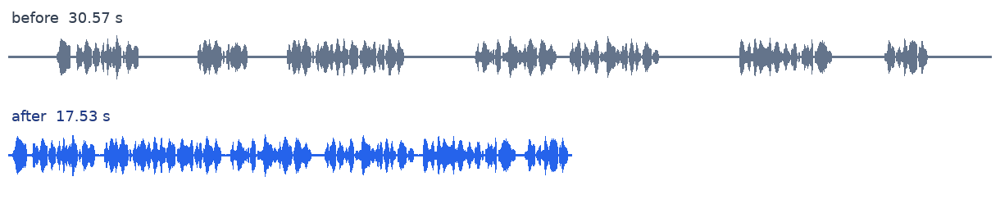

# video-cleaner

A small command-line tool that tidies up talking-head recordings:

- **Removes long silences.** Pauses longer than 0.6 s below −35 dB are cut, keeping 0.15 s of pause next to the speech so words are not clipped.
- **Removes repeated takes.** When the speaker starts a sentence, stops and says it again, only the last take is kept. Detection uses word-level transcription ([faster-whisper](https://github.com/SYSTRAN/faster-whisper) on the CPU) and fuzzy matching between consecutive sentences.
- **Explains itself.** Besides the rendered video (via ffmpeg) it writes an edit decision list (JSON) and a short report: original and final duration, and the number and kind of cuts.

```console
$ video-cleaner demo/output/talking_head.mp4 --language en
...
  original duration  0:30.57  (30.57 s)
  final duration     0:17.51  (17.51 s)
  removed            13.05 s  (42.7 %)

  cuts               6
    silence            5 cuts     8.74 s
    retake             1 cut      4.31 s

  removed takes
    0:04.20-0:08.51  "Today I want to show you."
                     restarted as "Today I want to show you how this tool cleans up a recording." (similarity 1.00)
```

## Demo

`demo/run_demo.sh` builds a synthetic 30-second clip (an espeak-ng voice over a plain ffmpeg background, with the caption and the source time burnt in) and cleans it. The clip contains:

- seven spoken lines, 1.5 s of silence before the first and 2 s after the last;
- pauses of 1.2 to 2.5 s between lines, plus one short 0.4 s pause that must be kept;
- one abandoned take: *"Today I want to show you"* … *"Today I want to show you how this tool cleans up a recording."*;
- two sentences that start alike but are both meant to stay: *"The first step finds the long pauses."* / *"The second step finds the repeated takes."*

Results with the Whisper `base` model on the CPU:

| | Before | After |
|---|---|---|
| Duration (EDL) | 30.57 s | 17.51 s (−13.05 s, −42.7 %) |
| Rendered file | 30.57 s | 17.53 s (video rounds up to whole frames) |
| Silences ≥ 0.6 s | 7 | 0: 5 silence cuts (8.74 s); the 2 pauses around the abandoned take went with the retake cut |
| Takes of the repeated sentence | 2 | 1: 1 retake cut (4.31 s, similarity 1.00) |
| Short pause, similar-but-different sentences | kept | kept |



Transcribing the cleaned file again gives all six remaining sentences, in order and unclipped. Cleaning took 5.1 s on a 2-core CPU (transcription 2.9 s including model load); the `tiny` model produced exactly the same edit in 4.4 s. The model was downloaded from the Hugging Face Hub on first use. The demo can also run with no model at all, using the transcript the generator derives from its script:

```bash
demo/run_demo.sh                    # needs espeak-ng and ffmpeg; downloads Whisper base once
demo/run_demo.sh --model tiny
demo/run_demo.sh --transcript demo/output/talking_head.transcript.json   # no Whisper
```

The last command gives the same 17.51 s edit. Outputs go to `demo/output/`.

## Install

ffmpeg and ffprobe must be on your `PATH` (for example `sudo apt install ffmpeg`). Then, from a checkout of this repository:

```bash
pip install -r requirements.txt      # faster-whisper
python -m video_cleaner --help
```

or `pip install .` to get a `video-cleaner` command. The first transcription downloads the chosen Whisper model (about 75 MB for `tiny`, 140 MB for `base`) to the Hugging Face cache. To work offline, point `--model` at a local model directory, or skip Whisper with `--transcript` or `--no-retakes`.

## Usage

```bash
video-cleaner talk.mp4                          # talk.clean.mp4 plus sidecar files
video-cleaner talk.mp4 -o out/talk.mp4 --language en
video-cleaner talk.mp4 --dry-run                # analyse only: EDL and report, no rendering
video-cleaner talk.mp4 --no-retakes             # silences only, no transcription
video-cleaner talk.mp4 --transcript talk.clean.words.json --similarity 0.8
                                                # re-tune without transcribing again
```

| Option | Default | Meaning |
|---|---|---|
| `-o, --output` | `<input>.clean.mp4` | rendered file; sidecar files are named after it |
| `--dry-run` | | write the EDL and report, do not render |
| `--silence-threshold DB` | `-35` | audio quieter than this counts as silence |
| `--min-silence SEC` | `0.6` | remove silences at least this long |
| `--padding SEC` | `0.15` | pause kept next to speech at every cut |
| `--no-silence` | | keep all silences |
| `--no-retakes` | | keep repeated takes (skips transcription) |
| `--transcript JSON` | | word-level transcript to use instead of Whisper |
| `--model` | `base` | faster-whisper model (`tiny`, `base`, `small`, …) or a local directory |
| `--language` | auto | spoken language, e.g. `en` |
| `--device` | `cpu` | `cpu` or `cuda` |
| `--similarity 0-1` | `0.85` | minimum fuzzy similarity between two takes |
| `--min-take-words N` | `2` | ignore abandoned takes shorter than N words |
| `--sentence-gap SEC` | `1.0` | a pause this long between words also ends a sentence |
| `--crf`, `--preset` | `20`, `veryfast` | x264 settings |
| `-q, --quiet` | | only print errors |

### Output files

For an output `talk.clean.mp4`:

- `talk.clean.mp4`: H.264 video and AAC audio (an audio-only input gives `.m4a`).
- `talk.clean.edl.json`: the edit decision list. Each cut has a `reason` (`silence` or `retake`), and retake cuts carry the removed text, the take that replaced it and the similarity. `keep` maps every kept source segment onto the output timeline:

  ```json
  "cuts": [
    {"start": 0.0, "end": 1.366, "duration": 1.366, "reason": "silence", "silence": [0.0, 1.516]},
    {"start": 4.196, "end": 8.508, "duration": 4.312, "reason": "retake",
     "removed_text": "Today I want to show you.",
     "matched_text": "Today I want to show you how this tool cleans up a recording.",
     "similarity": 1.0},
    ...
  ],
  "keep": [
    {"start": 1.366, "end": 4.196, "output_start": 0.0, "output_end": 2.83},
    {"start": 8.508, "end": 12.426, "output_start": 2.83, "output_end": 6.747},
    ...
  ]
  ```

  The file also records the settings used, the durations and a per-reason summary.
- `talk.clean.report.txt`: the report shown above.
- `talk.clean.words.json`: the word-level transcript. Pass it back with `--transcript` to try other settings without transcribing again.

## How it works

1. **Pauses.** ffmpeg's `silencedetect` lists every span quieter than `--silence-threshold` that lasts at least 0.15 s. Spans of at least `--min-silence` become *silence cuts* that leave `--padding` seconds next to the speech on each side. Leading and trailing silence is trimmed down to the padding.
2. **Transcription.** faster-whisper produces word timestamps, with its voice-activity filter on so that Whisper does not invent text in long silences. As a second guard, words that still fall entirely inside a long silence are ignored. With neither guard, the `tiny` model "heard" *"Thanks for watching, and I'll see you in the next video"* in the demo's silent ending, and the real closing sentence looked like an abandoned take.
3. **Repeated takes.** Words are grouped into sentences at `.` `!` `?` `…` or at pauses of at least `--sentence-gap`. Then each sentence is compared with the next one. The earlier sentence counts as an abandoned take when both of these hold:
   - *Similarity:* the fuzzy character-level ratio (Python's `difflib`) between the earlier sentence and the later one, or the beginning of the later one, is at least `--similarity`. Comparing against the beginning is what makes *"Today I want to show you"* match *"Today I want to show you how this tool…"* with a score of 1.00.
   - *End alignment:* the last word of the earlier sentence also appears near the start of the later one. An abandoned take stops somewhere inside the sentence that replaces it. Parallel sentences such as *"I want to show you the editor." / "I want to show you the terminal."* are 0.86 similar, but they differ exactly at the end, so both are kept.

   Filler words (*um*, *uh*, …) are ignored when comparing. Whisper often writes an abandoned take with a comma instead of a full stop (*"I want to, I want to show you"*), so restarts inside one sentence are also found, by looking for the sentence's opening words repeated later on. When there are several takes, only the last one survives.
4. **Cut boundaries.** A retake cut runs from the start of the abandoned take to the start of the take that follows. Whisper's word timestamps are often a few tenths of a second off: in the demo it placed the kept take 0.42 s early. So each boundary is moved into the actual pause that `silencedetect` found between the two words, keeping `--padding` of it.
5. **Edit decision list.** Overlapping cuts are resolved so that every removed second belongs to exactly one cut; a retake takes precedence over the silences inside it. Kept slivers shorter than 0.1 s are folded into a neighbouring cut.
6. **Rendering.** A single streaming ffmpeg pass does the cutting. `select` keeps the video frames inside the kept segments, and `setpts` shifts each frame back by the time removed before it, which also preserves variable-frame-rate timing. The audio is cut in 64-sample blocks with `aselect`, gets a 10 ms fade at each edit point, and is re-timed from its sample count. Segment boundaries are snapped to that block grid, so audio and video lose exactly the same time and cannot drift apart. "Which segment contains *t*?" is a balanced tree of `if()` expressions, so the cost per frame is O(log n).

   Memory use does not depend on the video length or the number of cuts. `demo/stress_test.py` cleans a 20-minute synthetic video with 750 cuts: it took 48 s with a peak of 86 MB, and the video−audio offset stayed within 16 ms of the source's own offset (half a frame at 30 fps). The obvious alternative, one `trim` + `concat` branch per segment, buffers decoded frames for every pending branch. On the same test it needed more than 5 GB and was killed.

## Plugging in another speech recogniser

Transcription is behind a one-method interface, so any ASR system (or a hand-written transcript) can be used:

```python
from pathlib import Path

from video_cleaner.pipeline import clean
from video_cleaner.transcribe import Word


class MyTranscriber:
    name = "my-asr"

    def transcribe(self, media: Path) -> list[Word]:
        # Words in time order; start and end in seconds.
        return [Word("Hello", 0.50, 0.82), Word("world.", 0.90, 1.30)]


clean(Path("talk.mp4"), transcriber=MyTranscriber())
```

From the command line, `--transcript` reads the same data from JSON: `{"words": [{"text": "Hello", "start": 0.5, "end": 0.82}, ...]}`. A bare list also works, `word` is accepted instead of `text`, and `probability` is optional.

The decision logic is also available without any I/O: `video_cleaner.pipeline.plan_edit(duration, silences=..., words=...)` returns the edit decision list.

## Project layout

```
video_cleaner/
  cli.py          command-line interface
  pipeline.py     Options, plan_edit() (pure decision logic) and clean() (the whole run)
  silence.py      silencedetect parsing and silence cuts
  retakes.py      sentence splitting, take matching and retake cuts
  timeline.py     cuts, kept segments and the edit decision list
  transcribe.py   Transcriber interface, faster-whisper and JSON transcribers
  ffmpeg.py       probing and the single-pass rendering filter graph
  report.py       the text report
tests/            unit and end-to-end tests, including a fake transcriber
demo/             make_clip.py, run_demo.sh, stress_test.py
```

## Tests

```bash
pip install -r requirements-dev.txt
python -m pytest     # 70 tests, about 1 s
ruff check .
```

None of the tests needs Whisper or a model download. The cut logic is tested with hand-written transcripts and a `FakeTranscriber` (`tests/fakes.py`) that implements the transcriber interface. The end-to-end tests render short tone clips with ffmpeg and are skipped when ffmpeg is not installed. The filter-graph expressions are checked by evaluating them in Python.

## Limitations

- **Near-verbatim restarts only.** A reworded restart such as *"Today I'm going to show you"* → *"Today I want to show you how…"* (similarity 0.82) is kept. Lowering `--similarity` catches more restarts but risks cutting sentences that merely start alike. *"We need three things." / "We need four things."* (0.82) are told apart only by that threshold.
- **Deliberate repetition looks like a retake.** Rhetorical repetition (*"We choose to go to the Moon. We choose to go to the Moon in this decade…"*) is cut. Use `--dry-run` on important material and read the report.
- **Only consecutive sentences are compared.** A restart after an interjection that forms its own sentence (*"…let me start again."*) is not detected. Filler-only sentences (*"Um."*) are skipped, though.
- **It depends on the transcript.** If Whisper leaves out the abandoned words, which it sometimes does with disfluencies, there is nothing to match; the silences are still removed. Sentence splitting relies partly on Whisper's punctuation.
- **Silence is a plain level threshold.** Music or noise above `--silence-threshold` is not treated as silence, and loud breaths are kept.
- **Video is re-encoded** (H.264 CRF 20, AAC 192 kb/s) so that cuts are frame-accurate. Only the first video and audio streams are kept; subtitles, chapters and other tracks are dropped. Cut points are rounded to whole video frames and to 1.3 ms audio blocks.
- **Limited testing.** It was tested on Linux x86-64 (CPU only) with Python 3.11, ffmpeg 6.1 and faster-whisper 1.2.1. Filter graphs over 100 kB are handed to ffmpeg 7+ with a different option (`-/filter_complex`), which has not been exercised here. The default thresholds were checked against the synthetic demo and the unit-test cases, not tuned on a corpus of real recordings. Real false starts, background noise and cross-talk are harder than an espeak-ng voice.

## License

MIT; see [LICENSE](LICENSE).
